# Fans' Benefits | Adding Seq2Seq Multi-Step Prediction Model

This period, we continue to update the multi-step forecasting family set. Building on the addition of a \"Transformer-based Combination Prediction Model\" from the previous issue:
\t  
We have added a Seq2Seq multi-step prediction model, and now the family set model has reached 27, with extremely high cost-performance ratio!
\t  
● Environment Framework: Python 3.9, PyTorch 1.8 and above can be run.
● Supplementary documents: detailed tutorials on environmental configuration and installation, as well as documentation on models and parameters.
● Usage Object: Paper requirements, graduation design requirements.
● Code Guarantee: The code comments are detailed and ready to run.
Including complete process data code processing:
Multi-step prediction dataset creation, data loading, model definition, parameter setting, model training, model testing, prediction visualization, model evaluation.
Preface
This article is based on the previously introduced power transformer (data set attached at the end of this document) and introduces a multi-step prediction model based on \tSeq2Seq\t network. For more detailed information about the power transformer dataset, please refer to the following text:
Introduction to the Power Transformer Dataset and Preprocessing
1 Data Preprocessing and Visualization of Electric Power Transformers
1.1 Import data
1.2 Multi-step Preprocessing for Prediction
2 Introduction to Seq2Seq
\tSeq2Seq (Sequence-to-Sequence) model is a deep learning model that processes sequence data, widely used in tasks such as machine translation, speech recognition, and text summarization. Its core idea is to convert one sequence (such as a sentence) into another sequence of varying lengths.
2.1 Seq2Seq Model Architecture
Encoder-Decoder Architecture: The Seq2Seq model typically consists of an encoder and a decoder. The encoder encodes the input sequence into a fixed-length context vector, while the decoder generates the output sequence using this vector.
1. RNN/LSTM/GRU Units: The encoder and decoder are typically constructed using Recurrent Neural Networks (RNN), Long Short-Term Memory networks (LSTM), or Gated Recurrent Units (GRU).
2.2 Multi-step Prediction
Single-step prediction: The decoder generates an output at each time step, relying on the predictions from previous time steps.
Multi-step prediction: Predictions need to be generated over multiple time steps. Common strategies include:
Direct multi-step prediction: The decoder directly predicts multiple time steps.
Recursive prediction: Use the prediction from the previous step as input for the next step, which can easily introduce error accumulation issues.
Output correction: Partially use the true value instead of the previous step's prediction as input.
In Seq2Seq, the decoder continuously generates predicted values for multiple time steps.
2.3 What is the difference between CNN-LSTM and Seq2Seq?
(1) CNN-LSTM Structure
Features:
Hybrid architecture: Combining Convolutional Neural Networks (CNN) and Long Short-Term Memory networks (LSTM).
Feature extraction and temporal modeling: Typically used for extracting features from spatiotemporal data and then modeling them sequentially.
Structure:
CNN part: Used for extracting local features of the input data. For image data, CNN can extract spatial features; for time series data, a 1D-CNN can extract local temporal features.
LSTM part: Used for processing the features extracted by the CNN and modeling these features sequentially. LSTM is suitable for capturing long-term dependencies.
(2) Seq2Seq Structure
\tFeatures\tSequence-to-sequence: Designed for mapping one sequence to another.
Encoder-decoder architecture: Typically consists of an encoder and a decoder.
\tStructure\tEncoder part: Encodes the input sequence into a fixed-length context vector (hidden state).
Decoder part: Generate target sequences based on context vectors.
Application scenarios: Machine translation translates a sentence from one language into another.
Text generation: For example, chatbots, automatic summaries, etc.
Temporal data prediction: For example, multi-step time series forecasting.
(3) Comparison and Summary
\t  
3 Comparison of CNN-LSTM and Seq2Seq for Multi-Step Prediction
\t3.1 CNN-LSTM Multi-Step Prediction Model
(1) Model Evaluation:
(2) Visualization of Prediction Results
\t3.2 Seq2Seq multi-step prediction model
(1) Model Evaluation:
(2) Visualization of Prediction Results
\t  
Click to download: Complete original data, Python code
Previously Featured Content:
Time Series Forecasting: Analysis and comparison of LSTM, ARIMA, Holt-Winters, SARIMA models
Wind Speed Prediction (Part 1) Data Set Introduction and Preprocessing
Wind Speed Prediction (II) EMD-LSTM Model Based on Pytorch
Wind Speed Prediction (III) EMD-LSTM-Attention Model
Wind Speed Prediction (IV) EMD-Transformer Model Based on Pytorch
Wind Speed Prediction (5) EMD-CNN-LSTM Model Based on Pytorch
Wind Speed Prediction (VI) - EMD-CNN-GRU Parallel Model Based on Pytorch
CEEMDAN + Combination Forecasting Model (BiLSTM-Attention + ARIMA)
CEEMDAN + Combination Prediction Model (CNN-LSTM + ARIMA)
CEEMDAN + Combination Prediction Model (Transformer - BiLSTM + ARIMA)
CEEMDAN + Combination Prediction Model (CNN-Transformer + ARIMA)
Multi-Feature Variable Sequence Forecasting (I) - CNN-LSTM Wind Speed Forecasting Model
Multi-Feature Variable Sequence Forecasting (II) - CNN-LSTM-Attention Wind Speed Forecasting Model
Multi-Feature Variable Sequence Forecasting (III) - CNN-Transformer Wind Speed Forecasting Model
Multi-Feature Variable Sequence Forecasting (IV) Transformer-BiLSTM Wind Speed Forecasting Model
Multi-Feature Variable Sequence Forecasting (V) CEEMDAN+CNN-LSTM Wind Speed Forecasting Model
Multi-Feature Variable Sequence Forecasting (VI) CEEMDAN+CNN-Transformer Wind Speed Forecasting Model
Prediction Model Based on the Particle Swarm Optimization Algorithm SSA - CEEMDAN-BiLSTM-Attention
Prediction Model Based on the Particle Swarm Optimization Algorithm SSA - CEEMDAN-Transformer-BiGRU
Superior Prediction Model: Secondary Decomposition-Combination Prediction
Multi-Feature Variable Sequence Forecasting (VII) CEEMDAN+Transformer-BiLSTM Prediction Model
Multi-Feature Variable Sequence Forecasting (VIII) Prediction Model Based on Particle Swarm Optimization Algorithm for CEEMDAN-SSA-BiLSTM
Multi-Feature Variable Sequence Forecasting (11) Prediction Model Based on Pytorch's TCN-GRU
VMD + CEEMDAN Secondary Decomposition, CNN-LSTM Prediction Model
VMD + CEEMDAN Secondary Decomposition, CNN-Transformer Prediction Model
VMD + CEEMDAN Secondary Decomposition, Transformer-BiGRU Prediction Model
Predictive Model Based on the Plumage Optimization Algorithm SSA - Complete Code Kit
Introduction to Electric Power Transformer Data Set and Preprocessing
 | Sci-1st Class High Innovation Predictive Model!
END

## Images

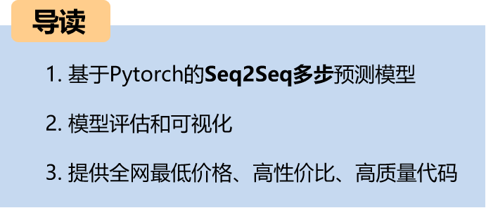
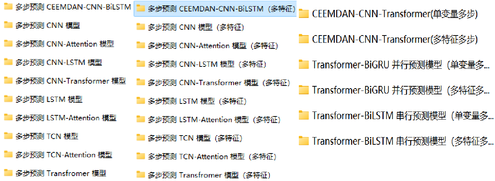
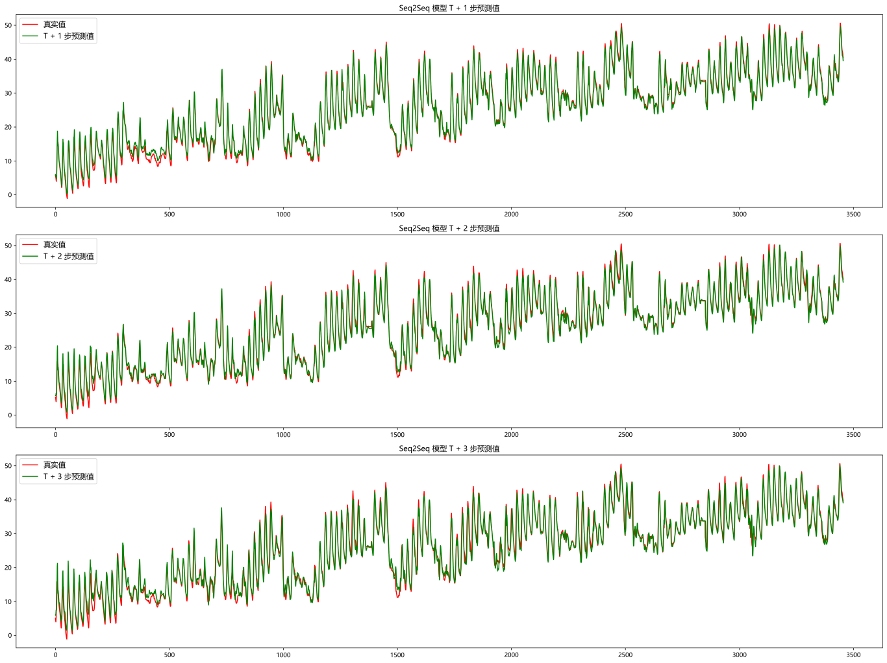
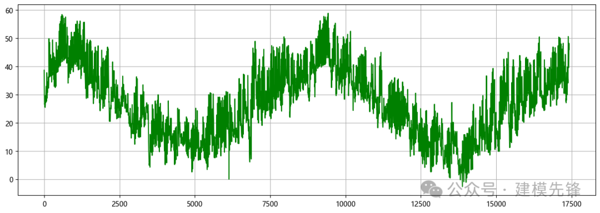
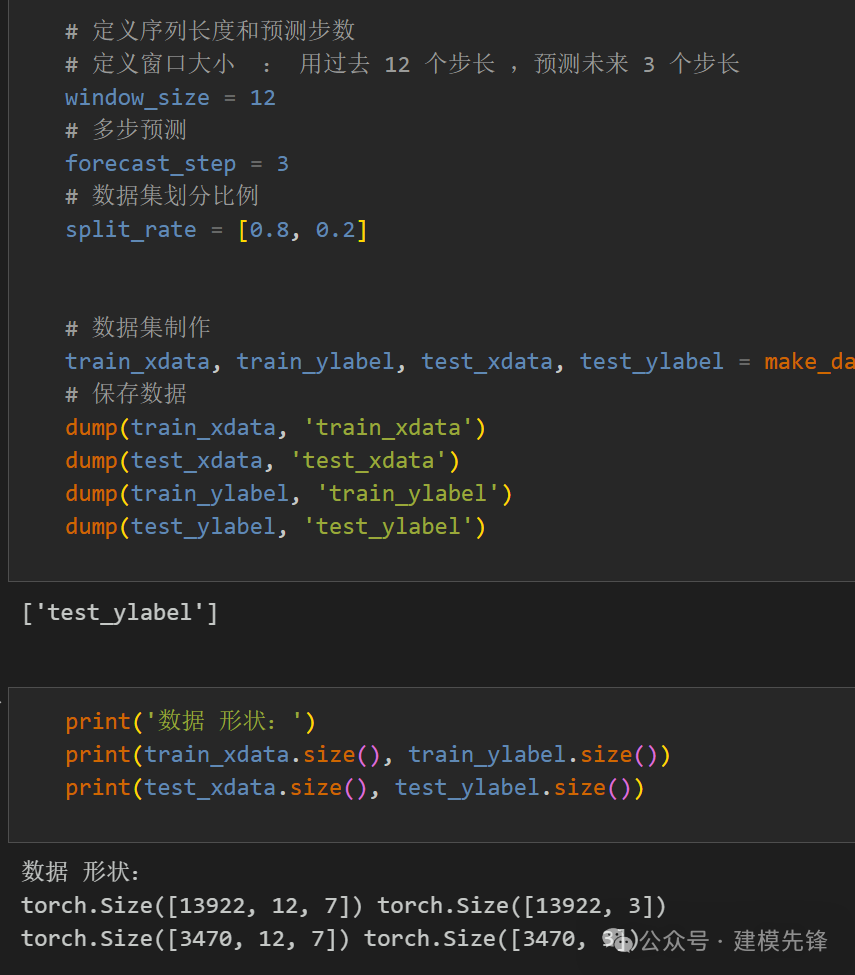
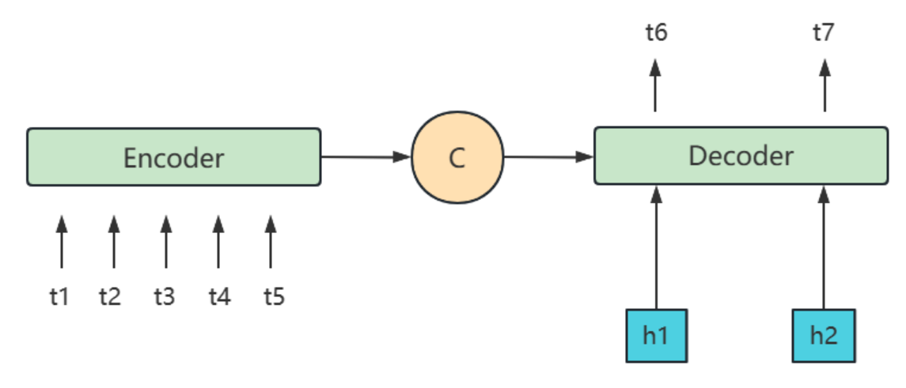
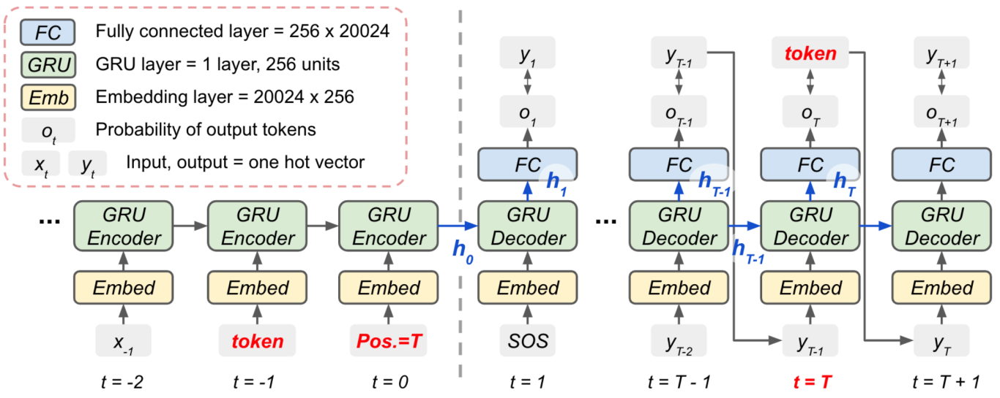
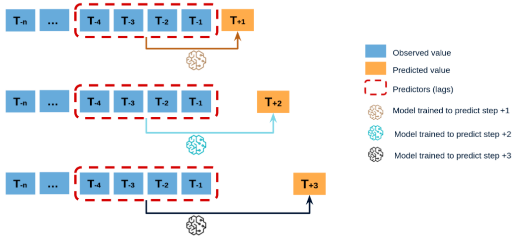
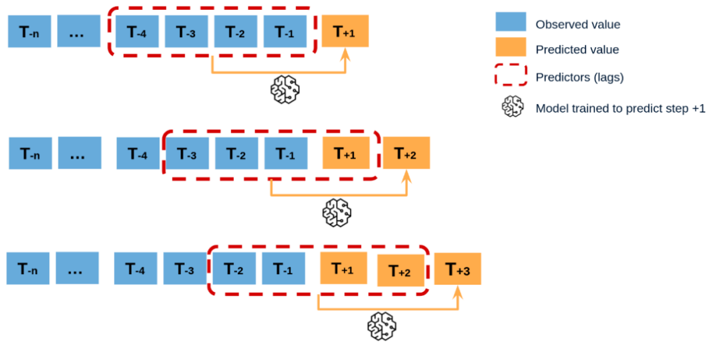
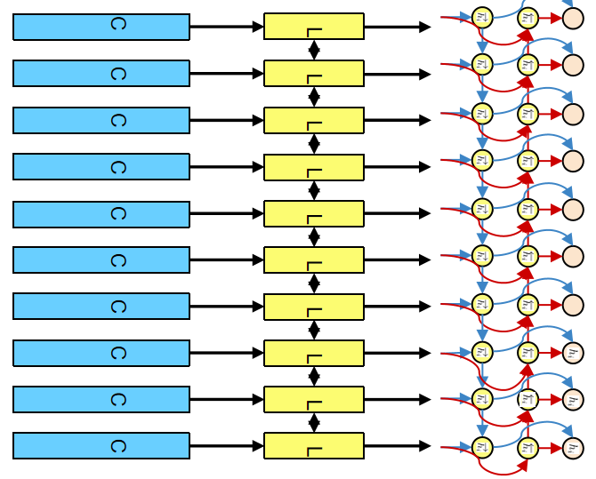
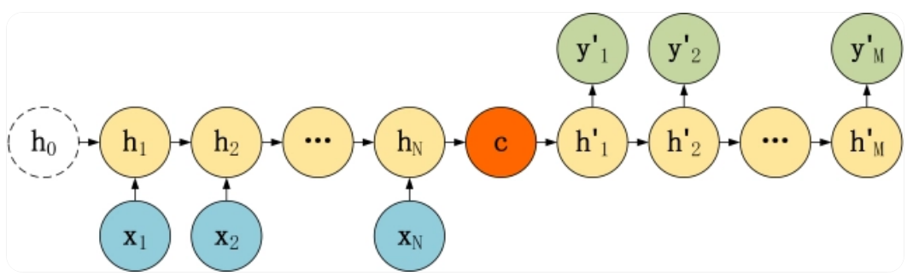
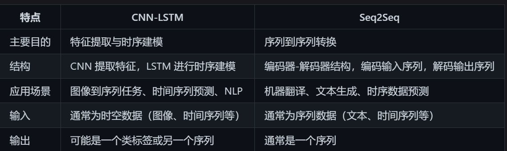
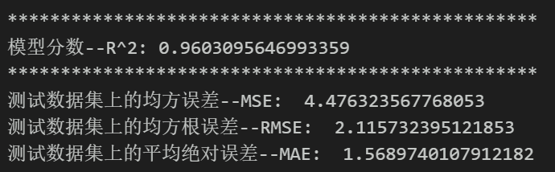

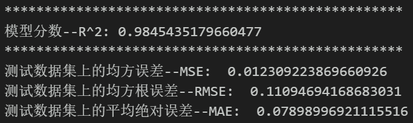

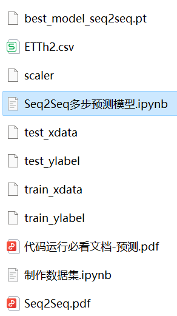

<!-- PAYMENT_BLOCK -->

## Get this dataset

- Payment link (Stripe): [Buy now](https://buy.stripe.com/3cs8yP7sY87d0vu9AB)
- Payment QR code: 

<!-- /PAYMENT_BLOCK -->
